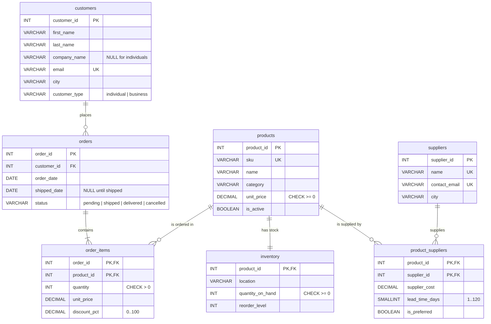

# GOL651 – Environnement Docker / Docker Environment

[](https://github.com/soubsoub/gol651-docker/actions/workflows/ci.yml)

Un environnement complet pour le cours GOL651 : Python, MySQL, SQLite, DuckDB, optimisation avec Pyomo, carnets Jupyter et Marimo, applications web.
*A complete environment for the GOL651 course: Python, MySQL, SQLite, DuckDB, Pyomo optimization, Jupyter and Marimo notebooks, web applications.*

**[Français](#français)** · **[English](#english)** · [Schéma de la base / Database schema](#schéma-de-la-base--database-schema) · [Responsables / Maintainers](#responsables--maintainers)

---

## Français

### Démarrage rapide

Prérequis : **Docker Desktop** installé et démarré (Windows, macOS) ou Docker Engine (Linux), et **Git**.

```bash
git clone https://github.com/soubsoub/gol651-docker.git gol651-docker
cd gol651-docker
cp .env.example .env                 # Windows PowerShell : Copy-Item .env.example .env
```

Ouvrez `.env` dans un éditeur et **changez les deux mots de passe** (`MYSQL_ROOT_PASSWORD`, `MYSQL_PASSWORD`) — *avant* le premier démarrage (voir [Mots de passe](#mots-de-passe)).

**Windows, une seule fois :** autorisez les scripts PowerShell du projet (sans droits d'administrateur) :

```powershell
Set-ExecutionPolicy -Scope CurrentUser -ExecutionPolicy RemoteSigned
Get-ChildItem -Recurse .\scripts\*.ps1 | Unblock-File
```

```bash
sh scripts/start.sh                  # Windows PowerShell : .\scripts\start.ps1
```

La première fois, la construction prend plusieurs minutes. Ensuite, ouvrez **http://localhost:8888** (Jupyter) et vérifiez l'installation :

```bash
docker compose exec jupyter python scripts/verify_environment.py
```

Le résultat doit se terminer par `Environment ready for GOL651`. C'est tout !

### Table des matières
1. [Contenu](#1-contenu) · 2. [Systèmes supportés](#2-systèmes-supportés) · 3. [Structure du dépôt](#3-structure-du-dépôt) · 4. [Configuration (.env)](#4-configuration-env) · 5. [Démarrer et arrêter](#5-démarrer-et-arrêter) · 6. [Adresses](#6-adresses-et-identifiants) · 7. [Jupyter](#7-jupyter-notebook-et-jupyterlab) · 8. [Bases de données](#8-bases-de-données) · 9. [Optimisation](#9-optimisation-pyomo) · 10. [Applications web](#10-applications-web) · 11. [Exemples](#11-exemples) · 12. [Vérification](#12-vérification) · 13. [Données et persistance](#13-données-et-persistance) · 14. [Réinitialiser](#14-réinitialiser) · 15. [Dépannage](#15-dépannage) · 16. [Sécurité](#16-sécurité) · 17. [Signaler un problème](#17-signaler-un-problème)

### 1. Contenu

| Service | Rôle | Démarrage |
|---|---|---|
| `mysql` | Serveur MySQL 8.4 (bases `gol651` et `gol651_exercises`) | par défaut |
| `phpmyadmin` | Administration web de MySQL | par défaut |
| `jupyter` | Jupyter Notebook (JupyterLab sur demande) | par défaut |
| `marimo` | Carnets réactifs Marimo | profil `marimo` |
| `streamlit`, `fastapi`, `flask` | Applications web et API | profil `web` |

Tous les services Python utilisent **une seule image Python 3.12**, qui contient : NumPy, Pandas, SciPy, scikit-learn, Matplotlib, Plotly, OpenPyXL, PyArrow, Requests, httpx, SQLAlchemy, PyMySQL, mysql-connector-python, DuckDB, Pydantic, Pyomo et les solveurs **HiGHS**, **CBC** et **GLPK**.

**SQLite** et **DuckDB** sont des bases de données *fichiers* : pas de serveur, les fichiers sont dans `data/sqlite/` et `data/duckdb/`. **MySQL Workbench** s'installe sur *votre ordinateur*, pas dans Docker.

### 2. Systèmes supportés

| Système | Ce qu'il faut | Remarques |
|---|---|---|
| **Windows 10/11** | Docker Desktop avec le moteur **WSL2** | Activez la virtualisation dans le BIOS si Docker le demande. Utilisez PowerShell et les scripts `.ps1`. |
| **macOS Intel** | Docker Desktop | Scripts `.sh` dans le Terminal. |
| **macOS Apple Silicon (M1–M5)** | Docker Desktop | L'image est **native ARM64** : aucune émulation, n'activez pas Rosetta pour Docker. |
| **Linux** | Docker Engine + plugin `docker compose` | Réglez `LOCAL_UID`/`LOCAL_GID` dans `.env` (voir section 4). |

Vérifiez votre installation : `docker version` puis `docker compose version`.

### 3. Structure du dépôt

```text
gol651-docker/
├── docker-compose.yml        services, ports, volumes
├── .env.example              modèle de configuration (copiez-le en .env)
├── docker/python/            image Python commune (Dockerfile)
├── requirements/             dépendances Python (requirements.in + verrou uv)
├── mysql/init/               initialisation MySQL (schéma + données d'enseignement)
├── notebooks/                vos carnets Jupyter   (examples/ : 3 carnets d'exemple)
├── marimo/                   vos carnets Marimo    (demo_app.py)
├── streamlit/ fastapi/ flask/  applications web d'exemple
├── python/  sql/             VOS scripts Python et SQL (vides au départ)
├── examples/
│   ├── databases/            MySQL, SQLite, DuckDB, transactions
│   └── optimization/         Pyomo : programme linéaire et en nombres entiers
├── data/
│   ├── datasets/             jeux de données fournis (shipments.csv)
│   ├── sqlite/  duckdb/      vos fichiers de bases de données
└── scripts/                  démarrer, arrêter, réinitialiser, vérifier
```

Les dossiers sont **partagés** entre votre ordinateur et les conteneurs : modifiez un fichier dans VS Code, le changement est immédiatement visible dans Docker.

### 4. Configuration (.env)

#### Mots de passe
`MYSQL_ROOT_PASSWORD` (administrateur) et `MYSQL_PASSWORD` (utilisateur du cours `gol651`). Utilisez des valeurs simples : lettres, chiffres, `_` et `-`.

> **Important :** MySQL lit ces mots de passe **uniquement au premier démarrage**. Changer `.env` ensuite ne modifie pas le mot de passe enregistré dans MySQL et provoque une erreur `Access denied`. Pour changer de mot de passe plus tard, il faut une [réinitialisation complète](#14-réinitialiser).

#### Ports
Si un port est déjà utilisé sur votre ordinateur, changez seulement la valeur dans `.env` : `MYSQL_PORT`, `PHPMYADMIN_PORT`, `JUPYTER_PORT`, `MARIMO_PORT`, `STREAMLIT_PORT`, `FASTAPI_PORT`, `FLASK_PORT`.

#### Linux seulement
Pour que les fichiers créés dans les conteneurs vous appartiennent, mettez dans `.env` le résultat de `id -u` et `id -g` :
```bash
LOCAL_UID=1000
LOCAL_GID=1000
```
puis reconstruisez : `docker compose build`. Windows et macOS : laissez les valeurs par défaut.

### 5. Démarrer et arrêter

| Action | macOS / Linux | Windows PowerShell | Commande Docker équivalente |
|---|---|---|---|
| Démarrer (par défaut) | `sh scripts/start.sh` | `.\scripts\start.ps1` | `docker compose up -d --wait` |
| + Marimo | `sh scripts/start.sh marimo` | `.\scripts\start.ps1 marimo` | `docker compose --profile marimo up -d` |
| + applications web | `sh scripts/start.sh web` | `.\scripts\start.ps1 web` | `docker compose --profile web up -d` |
| Tout | `sh scripts/start.sh all` | `.\scripts\start.ps1 all` | `docker compose --profile marimo --profile web up -d` |
| Arrêter (aucune perte) | `sh scripts/stop.sh` | `.\scripts\stop.ps1` | `docker compose --profile marimo --profile web down` |
| État des services | | | `docker compose ps` |

L'image est construite automatiquement au premier démarrage. **Après une mise à jour du dépôt**, reconstruisez-la une fois : `docker compose build`. Si l'enseignant l'indique (scripts MySQL modifiés), faites aussi une [réinitialisation complète](#14-réinitialiser).

Si Windows bloque les scripts (« l'exécution de scripts est désactivée ») : faites l'étape « Windows, une seule fois » du démarrage rapide, ou utilisez `powershell -ExecutionPolicy Bypass -File .\scripts\start.ps1`.

### 6. Adresses et identifiants

| Service | Adresse | Identifiants |
|---|---|---|
| Jupyter Notebook | http://localhost:8888 | aucun |
| JupyterLab | http://localhost:8888/lab | aucun |
| phpMyAdmin | http://localhost:8080 | `gol651` / valeur de `MYSQL_PASSWORD` |
| MySQL (Workbench) | `127.0.0.1`, port `3306` | `gol651` / valeur de `MYSQL_PASSWORD` |
| Marimo | http://localhost:2718 | aucun |
| Streamlit | http://localhost:8501 | — |
| FastAPI | http://localhost:8000 · documentation http://localhost:8000/docs | — |
| Flask | http://localhost:5000 | — |

(Les ports changent si vous les avez modifiés dans `.env`.)

### 7. Jupyter Notebook et JupyterLab

- **Jupyter Notebook** (interface par défaut) : http://localhost:8888
- **JupyterLab** (interface plus complète, sur demande) : http://localhost:8888/lab — même serveur, mêmes fichiers. Pour revenir : http://localhost:8888/tree
- Les carnets d'exemple sont dans `notebooks/examples/`. Créez vos carnets dans `notebooks/`.

### 8. Bases de données

#### Comment se connecter : la règle à retenir

| Le code s'exécute… | Hôte MySQL | Pourquoi |
|---|---|---|
| **sur votre ordinateur** (Workbench, navigateur) | `localhost` / `127.0.0.1` | le port 3306 est publié sur votre machine |
| **dans un conteneur** (Jupyter, Streamlit, FastAPI…) | `mysql` | les conteneurs se trouvent par le **nom du service** |

#### MySQL : deux bases identiques
| Base | Rôle |
|---|---|
| `gol651` | copie de **référence** — gardez-la intacte |
| `gol651_exercises` | copie d'**exercice** — modifiez-la librement ; [restaurable à tout moment](#14-réinitialiser) |

Les deux contiennent le même schéma d'une entreprise de distribution fictive au Québec : `customers` (12), `suppliers` (6), `products` (20), `product_suppliers` (24), `inventory` (20), `orders` (25), `order_items` (59), et trois vues `v_order_totals`, `v_customer_sales`, `v_low_stock`. Il illustre les clés primaires et étrangères, les relations un-à-un, un-à-plusieurs et plusieurs-à-plusieurs, `NOT NULL`, `UNIQUE`, `CHECK`, `DEFAULT`, les index, les vues et les transactions. Voir le [diagramme](#schéma-de-la-base--database-schema).

#### MySQL Workbench (sur votre ordinateur)
| Champ | Valeur |
|---|---|
| Connection Method | Standard TCP/IP |
| Hostname | `127.0.0.1` (équivalent à `localhost`, plus fiable sous Windows) |
| Port | `3306` (ou `MYSQL_PORT` de `.env`) |
| Username | `gol651` |
| Password | « Store in Vault… » → valeur de `MYSQL_PASSWORD` |
| Default Schema | `gol651` |

Test de connexion :
```sql
SELECT VERSION();
SELECT DATABASE();
SHOW TABLES;
```

#### phpMyAdmin
http://localhost:8080, utilisateur `gol651`, mot de passe `MYSQL_PASSWORD`. phpMyAdmin tourne dans Docker et joint MySQL par le nom de service `mysql`.

#### SQLite et DuckDB
Pas de serveur : ce sont des fichiers. Rangez-les dans `data/sqlite/` et `data/duckdb/` pour les conserver. Exemples : `examples/databases/sqlite_examples.py` et `duckdb_examples.py`.

#### Adresses SQLAlchemy
| Base | URL (dans un conteneur) |
|---|---|
| MySQL | `mysql+pymysql://gol651:<mot_de_passe>@mysql:3306/gol651` |
| SQLite | `sqlite:///data/sqlite/ma_base.sqlite` |
| DuckDB | `duckdb:///data/duckdb/ma_base.duckdb` |

Ne mettez pas le mot de passe dans le code : lisez-le avec `os.environ["MYSQL_PASSWORD"]` (voir `examples/databases/db_config.py`).

### 9. Optimisation (Pyomo)

Pyomo avec trois solveurs : **HiGHS** (`SolverFactory("highs")`, via `highspy`), **CBC** (`"cbc"`) et **GLPK** (`"glpk"`). Exemples : `examples/optimization/production_plan_lp.py` (programme linéaire et prix duaux) et `facility_location_milp.py` (localisation d'entrepôts, nombres entiers), ainsi que le carnet `notebooks/examples/03_optimization_pyomo.ipynb`. Ipopt (optimisation non linéaire) ne fait **pas** partie de l'environnement.

### 10. Applications web

Démarrez-les avec `sh scripts/start.sh web` (ou `marimo`). Modifiez le fichier et enregistrez : l'application se recharge.

| Application | Fichier | Adresse |
|---|---|---|
| Marimo | `marimo/demo_app.py` | http://localhost:2718 |
| Streamlit | `streamlit/app.py` + `streamlit/page_*.py` | http://localhost:8501 |
| FastAPI | `fastapi/main.py` | http://localhost:8000/docs |
| Flask | `flask/app.py` | http://localhost:5000 |

**L'application Streamlit** comporte un menu à gauche :
- **Tutoriel** (4 pages courtes) : widgets et affichage, mise en page, état et formulaires, cache ;
- **Applications** : quantité économique (EOQ), tableau de bord des ventes (`gol651`), gestion des commandes avec transactions (écrit dans `gol651_exercises`), optimisation de la production avec Pyomo.

Chaque page affiche son propre code en bas (« Code de cette page »). Pour créer votre page : copiez un fichier `page_*.py`, puis ajoutez-le à la liste `pages` dans `streamlit/app.py`.

Si une modification ne s'affiche pas : `docker compose restart streamlit` (ou `fastapi`, `flask`, `marimo`).

### 11. Exemples

Exécutez un script **dans le conteneur** :
```bash
docker compose exec jupyter python examples/databases/mysql_sqlalchemy.py
```

| Fichier | Contenu |
|---|---|
| `examples/databases/mysql_pymysql.py` | PyMySQL, requêtes paramétrées, jointures, COMMIT / ROLLBACK |
| `examples/databases/mysql_connector.py` | mysql-connector-python, pool de connexions, violation de contrainte |
| `examples/databases/mysql_sqlalchemy.py` | SQLAlchemy, pool, transactions, `pandas.read_sql` |
| `examples/databases/mysql_transactions.sql` | transactions en SQL, à exécuter dans Workbench ou phpMyAdmin |
| `examples/databases/sqlite_examples.py` | sqlite3, clés étrangères, transactions, SQLAlchemy, Pandas |
| `examples/databases/duckdb_examples.py` | DuckDB en mémoire et fichier, DataFrame, CSV, Parquet, SQLAlchemy |
| `examples/optimization/*.py` | Pyomo : programme linéaire et en nombres entiers |
| `notebooks/examples/01…03` | NumPy/Pandas/Matplotlib, bases de données, optimisation |

Les exemples qui écrivent dans MySQL utilisent `gol651_exercises` et annulent leurs modifications.

Pour exécuter vos propres scripts : `docker compose exec jupyter python python/mon_script.py`. Pour un terminal dans le conteneur : `docker compose exec jupyter bash`.

### 12. Vérification

Toutes ces commandes s'exécutent **dans le conteneur** (pas besoin de Python sur votre ordinateur) :

| Commande | Vérifie |
|---|---|
| `docker compose exec jupyter python scripts/verify_environment.py` | tout l'environnement (bibliothèques, bases, solveurs) |
| `docker compose exec jupyter python scripts/verify_databases.py` | MySQL, schéma d'enseignement, contraintes, SQLite, DuckDB |
| `docker compose exec jupyter python scripts/verify_solvers.py` | HiGHS, CBC, GLPK (résolution réelle de modèles) |
| `docker compose exec jupyter python scripts/verify_examples.py` | exécute tous les exemples, carnets et applications |

Chaque ligne affiche `[PASS]` ou `[FAIL]`, avec une piste de solution en cas d'échec.

### 13. Données et persistance

| Commande | Base MySQL | Fichiers (`data/`, carnets, code) |
|---|---|---|
| `stop` / `docker compose down` | **conservée** | conservés |
| `docker compose build` (reconstruction) | conservée | conservés |
| redémarrer l'ordinateur | conservée | conservés |
| `reset` / `docker compose down -v` | **SUPPRIMÉE puis recréée** | conservés |

MySQL est stocké dans un **volume Docker** (`mysql-data`) ; vos fichiers sont dans des dossiers ordinaires.

Un paquet installé avec `pip install` dans un conteneur **disparaît** quand le conteneur est recréé (`stop`/`start`, reconstruction). Si un paquet manque pour le cours, signalez-le à l'enseignant : il sera ajouté à l'image pour tout le monde.

**Sauvegarder MySQL** dans `sql/gol651_backup.sql` :
```bash
docker compose exec mysql sh -c 'MYSQL_PWD=$MYSQL_ROOT_PASSWORD mysqldump -uroot --databases gol651 gol651_exercises > /tmp/gol651_backup.sql'
docker compose cp mysql:/tmp/gol651_backup.sql sql/gol651_backup.sql
```
**Restaurer** cette sauvegarde :
```bash
docker compose cp sql/gol651_backup.sql mysql:/tmp/gol651_backup.sql
docker compose exec mysql sh -c 'MYSQL_PWD=$MYSQL_ROOT_PASSWORD mysql -uroot < /tmp/gol651_backup.sql'
```

### 14. Réinitialiser

Du moins au plus radical :

| Niveau | Commande | Effet |
|---|---|---|
| 1. Redémarrer | `docker compose restart` | relance les services, rien n'est perdu |
| 2. Arrêter | `sh scripts/stop.sh` / `.\scripts\stop.ps1` | supprime les conteneurs, rien n'est perdu |
| 3. Reconstruire l'image | `docker compose build` puis `sh scripts/start.sh` | après une mise à jour des dépendances ; rien n'est perdu |
| 4. Restaurer `gol651_exercises` | `sh scripts/restore-exercises.sh` / `.\scripts\restore-exercises.ps1` | recrée **seulement** la base d'exercice ; `gol651` est intacte |
| 5. Réinitialisation complète | `sh scripts/reset.sh` / `.\scripts\reset.ps1` | **SUPPRIME toute la base MySQL**, puis la recrée |

> **ATTENTION :** le niveau 5 (`docker compose down -v`) supprime le volume MySQL et toutes ses données. Les scripts demandent de taper `yes`. Les fichiers de `data/sqlite/`, `data/duckdb/`, vos carnets et votre code ne sont pas touchés.

Si une reconstruction semble utiliser un cache corrompu : `docker compose build --no-cache`. N'utilisez `docker system prune` qu'en dernier recours : il supprime les images et caches de **tous** vos projets Docker.

### 15. Dépannage

Commandes de diagnostic (toujours sans danger) :
```bash
docker version
docker compose ps
docker compose logs mysql --tail=50       # ou jupyter, phpmyadmin, streamlit…
```

| Symptôme | Cause probable | Solution |
|---|---|---|
| `Cannot connect to the Docker daemon` / `docker: command not found` | Docker Desktop n'est pas démarré | Démarrez Docker Desktop, attendez « Engine running ». |
| Windows : erreur WSL2 / virtualisation | WSL2 absent ou désactivé | `wsl --install` (PowerShell administrateur), redémarrez ; activez la virtualisation dans le BIOS. |
| `.env not found` / `required variable MYSQL_PASSWORD is missing` | `.env` absent | `cp .env.example .env` (Windows : `Copy-Item .env.example .env`). |
| `port is already allocated` / `address already in use` | Un autre programme utilise le port | Changez le port dans `.env` (ex. `MYSQL_PORT=3307`), puis `sh scripts/start.sh`. |
| Workbench se connecte à « une autre » base | Un MySQL installé sur votre ordinateur utilise déjà 3306 | Mettez `MYSQL_PORT=3307` dans `.env` et utilisez le port 3307 dans Workbench. |
| macOS : port 5000 occupé | AirPlay utilise 5000 | `FLASK_PORT=5001` dans `.env`. |
| Windows : `ports are not available` … `forbidden by its access permissions` | Port réservé par Windows (Hyper-V/WSL) | `netsh interface ipv4 show excludedportrange protocol=tcp` montre les plages réservées ; choisissez un autre port dans `.env`. |
| Windows : `l'exécution de scripts est désactivée sur ce système` | Politique d'exécution PowerShell | Étape « Windows, une seule fois » du [démarrage rapide](#démarrage-rapide). |
| `Access denied for user 'gol651'` | Mot de passe changé dans `.env` après le premier démarrage | Remettez l'ancien mot de passe, ou [réinitialisation complète](#14-réinitialiser) (efface MySQL). |
| `mysql` reste `starting` / `unhealthy` | Premier démarrage en cours, ou erreur d'initialisation | Attendez 1–2 min ; sinon `docker compose logs mysql --tail=100`. |
| Tables d'enseignement absentes (`Table 'gol651.customers' doesn't exist`), ou la vérification indique une ancienne version (`initialized by release 'stage-1'`) | Volume MySQL créé par une ancienne version | [Réinitialisation complète](#14-réinitialiser) (efface MySQL). |
| `ModuleNotFoundError` | Python lancé sur votre ordinateur au lieu du conteneur | Utilisez `docker compose exec jupyter python …`. |
| Linux : `Permission denied` dans `notebooks/` ou `data/` | UID/GID différents | Réglez `LOCAL_UID`/`LOCAL_GID` (section 4), `docker compose build`. N'utilisez pas `chmod 777`. |
| Windows : `/bin/sh^M: bad interpreter` | Fins de ligne CRLF | `git config --global core.autocrlf input`, puis reclonez le dépôt. |
| Apple Silicon : `exec format error` | Image d'une autre architecture | `docker compose build --pull`. Ne forcez pas `platform: linux/amd64`. |

### 16. Sécurité

Jupyter et Marimo fonctionnent **sans mot de passe**, et les ports sont publiés uniquement sur `127.0.0.1` (`BIND_ADDRESS`) : seul votre ordinateur y a accès. C'est un environnement d'enseignement local : **ne l'exposez jamais à Internet** et ne mettez pas `BIND_ADDRESS=0.0.0.0` sur un réseau que vous ne contrôlez pas. Ne publiez jamais votre fichier `.env`.

### 17. Signaler un problème

Envoyez à l'enseignant : votre système (Windows, macOS Intel, macOS Apple Silicon, Linux), les résultats de `docker version` et `docker compose ps`, le message d'erreur exact et les dernières lignes du journal concerné (`docker compose logs <service> --tail=50`), ainsi que le résultat de `verify_environment.py`. **N'envoyez jamais vos mots de passe ni le contenu de `.env`.**

---

## English

### Quick start

Prerequisites: **Docker Desktop** installed and running (Windows, macOS) or Docker Engine (Linux), and **Git**.

```bash
git clone https://github.com/soubsoub/gol651-docker.git gol651-docker
cd gol651-docker
cp .env.example .env                 # Windows PowerShell: Copy-Item .env.example .env
```

Open `.env` in an editor and **change both passwords** (`MYSQL_ROOT_PASSWORD`, `MYSQL_PASSWORD`) — *before* the first start (see [Passwords](#passwords)).

**Windows, once only:** allow the project's PowerShell scripts (no administrator rights needed):

```powershell
Set-ExecutionPolicy -Scope CurrentUser -ExecutionPolicy RemoteSigned
Get-ChildItem -Recurse .\scripts\*.ps1 | Unblock-File
```

```bash
sh scripts/start.sh                  # Windows PowerShell: .\scripts\start.ps1
```

The first build takes several minutes. Then open **http://localhost:8888** (Jupyter) and verify the installation:

```bash
docker compose exec jupyter python scripts/verify_environment.py
```

The output must end with `Environment ready for GOL651`. That's it!

### Contents
1. [What is included](#1-what-is-included) · 2. [Supported systems](#2-supported-systems) · 3. [Repository structure](#3-repository-structure) · 4. [Configuration (.env)](#4-configuration-env-1) · 5. [Start and stop](#5-start-and-stop) · 6. [Addresses](#6-addresses-and-credentials) · 7. [Jupyter](#7-jupyter-notebook-and-jupyterlab) · 8. [Databases](#8-databases) · 9. [Optimization](#9-optimization-pyomo) · 10. [Web applications](#10-web-applications) · 11. [Examples](#11-examples) · 12. [Verification](#12-verification) · 13. [Data and persistence](#13-data-and-persistence) · 14. [Reset](#14-reset) · 15. [Troubleshooting](#15-troubleshooting) · 16. [Security](#16-security) · 17. [Reporting a problem](#17-reporting-a-problem)

### 1. What is included

| Service | Purpose | Started |
|---|---|---|
| `mysql` | MySQL 8.4 server (`gol651` and `gol651_exercises` databases) | default |
| `phpmyadmin` | MySQL web administration | default |
| `jupyter` | Jupyter Notebook (JupyterLab on demand) | default |
| `marimo` | Marimo reactive notebooks | profile `marimo` |
| `streamlit`, `fastapi`, `flask` | Web applications and APIs | profile `web` |

All Python services use **one Python 3.12 image** containing NumPy, Pandas, SciPy, scikit-learn, Matplotlib, Plotly, OpenPyXL, PyArrow, Requests, httpx, SQLAlchemy, PyMySQL, mysql-connector-python, DuckDB, Pydantic, Pyomo and the **HiGHS**, **CBC** and **GLPK** solvers.

**SQLite** and **DuckDB** are *file* databases: no server; files live in `data/sqlite/` and `data/duckdb/`. **MySQL Workbench** is installed on *your computer*, not in Docker.

### 2. Supported systems

| System | What you need | Notes |
|---|---|---|
| **Windows 10/11** | Docker Desktop with the **WSL2** engine | Enable virtualization in the BIOS if Docker asks. Use PowerShell and the `.ps1` scripts. |
| **macOS Intel** | Docker Desktop | `.sh` scripts in the Terminal. |
| **macOS Apple Silicon (M1–M5)** | Docker Desktop | The image is **native ARM64**: no emulation; do not enable Rosetta for Docker. |
| **Linux** | Docker Engine + `docker compose` plugin | Set `LOCAL_UID`/`LOCAL_GID` in `.env` (section 4). |

Check your installation: `docker version`, then `docker compose version`.

### 3. Repository structure

```text
gol651-docker/
├── docker-compose.yml        services, ports, volumes
├── .env.example              configuration template (copy it to .env)
├── docker/python/            shared Python image (Dockerfile)
├── requirements/             Python dependencies (requirements.in + uv lock)
├── mysql/init/               MySQL initialization (teaching schema + data)
├── notebooks/                your Jupyter notebooks   (examples/: 3 example notebooks)
├── marimo/                   your Marimo notebooks    (demo_app.py)
├── streamlit/ fastapi/ flask/  example web applications
├── python/  sql/             YOUR Python and SQL scripts (empty at first)
├── examples/
│   ├── databases/            MySQL, SQLite, DuckDB, transactions
│   └── optimization/         Pyomo: linear and integer programming
├── data/
│   ├── datasets/             provided datasets (shipments.csv)
│   ├── sqlite/  duckdb/      your database files
└── scripts/                  start, stop, reset, verify
```

Folders are **shared** between your computer and the containers: edit a file in VS Code and the change is immediately visible inside Docker.

### 4. Configuration (.env)

#### Passwords
`MYSQL_ROOT_PASSWORD` (administrator) and `MYSQL_PASSWORD` (course user `gol651`). Use simple values: letters, digits, `_` and `-`.

> **Important:** MySQL reads these passwords **only on the first start**. Changing `.env` afterwards does not change the password stored in MySQL and causes an `Access denied` error. To change a password later, a [full reset](#14-reset) is needed.

#### Ports
If a port is already used on your computer, change only its value in `.env`: `MYSQL_PORT`, `PHPMYADMIN_PORT`, `JUPYTER_PORT`, `MARIMO_PORT`, `STREAMLIT_PORT`, `FASTAPI_PORT`, `FLASK_PORT`.

#### Linux only
So that files created in containers belong to you, put the output of `id -u` and `id -g` in `.env`:
```bash
LOCAL_UID=1000
LOCAL_GID=1000
```
then rebuild: `docker compose build`. Windows and macOS: keep the defaults.

### 5. Start and stop

| Action | macOS / Linux | Windows PowerShell | Equivalent Docker command |
|---|---|---|---|
| Start (default) | `sh scripts/start.sh` | `.\scripts\start.ps1` | `docker compose up -d --wait` |
| + Marimo | `sh scripts/start.sh marimo` | `.\scripts\start.ps1 marimo` | `docker compose --profile marimo up -d` |
| + web apps | `sh scripts/start.sh web` | `.\scripts\start.ps1 web` | `docker compose --profile web up -d` |
| Everything | `sh scripts/start.sh all` | `.\scripts\start.ps1 all` | `docker compose --profile marimo --profile web up -d` |
| Stop (no data loss) | `sh scripts/stop.sh` | `.\scripts\stop.ps1` | `docker compose --profile marimo --profile web down` |
| Service status | | | `docker compose ps` |

The image is built automatically on the first start. **After updating the repository**, rebuild it once: `docker compose build`. If the instructor says so (MySQL scripts changed), also do a [full reset](#14-reset).

If Windows blocks scripts ("running scripts is disabled on this system"): do the "Windows, once only" step of the quick start, or use `powershell -ExecutionPolicy Bypass -File .\scripts\start.ps1`.

### 6. Addresses and credentials

| Service | Address | Credentials |
|---|---|---|
| Jupyter Notebook | http://localhost:8888 | none |
| JupyterLab | http://localhost:8888/lab | none |
| phpMyAdmin | http://localhost:8080 | `gol651` / value of `MYSQL_PASSWORD` |
| MySQL (Workbench) | `127.0.0.1`, port `3306` | `gol651` / value of `MYSQL_PASSWORD` |
| Marimo | http://localhost:2718 | none |
| Streamlit | http://localhost:8501 | — |
| FastAPI | http://localhost:8000 · documentation http://localhost:8000/docs | — |
| Flask | http://localhost:5000 | — |

(Ports differ if you changed them in `.env`.)

### 7. Jupyter Notebook and JupyterLab

- **Jupyter Notebook** (default interface): http://localhost:8888
- **JupyterLab** (richer interface, on demand): http://localhost:8888/lab — same server, same files. To go back: http://localhost:8888/tree
- Example notebooks are in `notebooks/examples/`. Create your own notebooks in `notebooks/`.

### 8. Databases

#### How to connect: the rule to remember

| The code runs… | MySQL host | Why |
|---|---|---|
| **on your computer** (Workbench, browser) | `localhost` / `127.0.0.1` | port 3306 is published on your machine |
| **in a container** (Jupyter, Streamlit, FastAPI…) | `mysql` | containers find each other by **service name** |

#### MySQL: two identical databases
| Database | Role |
|---|---|
| `gol651` | **reference** copy — keep it intact |
| `gol651_exercises` | **practice** copy — modify it freely; [restorable at any time](#14-reset) |

Both contain the same schema of a fictional Québec distribution company: `customers` (12), `suppliers` (6), `products` (20), `product_suppliers` (24), `inventory` (20), `orders` (25), `order_items` (59), and three views `v_order_totals`, `v_customer_sales`, `v_low_stock`. It demonstrates primary and foreign keys, one-to-one, one-to-many and many-to-many relationships, `NOT NULL`, `UNIQUE`, `CHECK`, `DEFAULT`, indexes, views and transactions. See the [diagram](#schéma-de-la-base--database-schema).

#### MySQL Workbench (on your computer)
| Field | Value |
|---|---|
| Connection Method | Standard TCP/IP |
| Hostname | `127.0.0.1` (same as `localhost`, more reliable on Windows) |
| Port | `3306` (or `MYSQL_PORT` from `.env`) |
| Username | `gol651` |
| Password | "Store in Vault…" → value of `MYSQL_PASSWORD` |
| Default Schema | `gol651` |

Connection test:
```sql
SELECT VERSION();
SELECT DATABASE();
SHOW TABLES;
```

#### phpMyAdmin
http://localhost:8080, user `gol651`, password `MYSQL_PASSWORD`. phpMyAdmin runs in Docker and reaches MySQL through the service name `mysql`.

#### SQLite and DuckDB
No server: they are files. Keep them in `data/sqlite/` and `data/duckdb/`. Examples: `examples/databases/sqlite_examples.py` and `duckdb_examples.py`.

#### SQLAlchemy URLs
| Database | URL (inside a container) |
|---|---|
| MySQL | `mysql+pymysql://gol651:<password>@mysql:3306/gol651` |
| SQLite | `sqlite:///data/sqlite/my_database.sqlite` |
| DuckDB | `duckdb:///data/duckdb/my_database.duckdb` |

Never put the password in code: read it with `os.environ["MYSQL_PASSWORD"]` (see `examples/databases/db_config.py`).

### 9. Optimization (Pyomo)

Pyomo with three solvers: **HiGHS** (`SolverFactory("highs")`, through `highspy`), **CBC** (`"cbc"`) and **GLPK** (`"glpk"`). Examples: `examples/optimization/production_plan_lp.py` (linear program and dual prices) and `facility_location_milp.py` (warehouse location, integer variables), plus the notebook `notebooks/examples/03_optimization_pyomo.ipynb`. Ipopt (nonlinear optimization) is **not** part of the environment.

### 10. Web applications

Start them with `sh scripts/start.sh web` (or `marimo`). Edit the file and save: the application reloads.

| Application | File | Address |
|---|---|---|
| Marimo | `marimo/demo_app.py` | http://localhost:2718 |
| Streamlit | `streamlit/app.py` + `streamlit/page_*.py` | http://localhost:8501 |
| FastAPI | `fastapi/main.py` | http://localhost:8000/docs |
| Flask | `flask/app.py` | http://localhost:5000 |

**The Streamlit application** has a menu on the left:
- **Tutorial** (4 short pages): widgets and display, layout, state and forms, caching;
- **Applications**: economic order quantity (EOQ), sales dashboard (`gol651`), order management with transactions (writes to `gol651_exercises`), production optimization with Pyomo.

Every page shows its own code at the bottom ("Page source"). To create your own page: copy a `page_*.py` file, then add it to the `pages` list in `streamlit/app.py`.

If a change does not appear: `docker compose restart streamlit` (or `fastapi`, `flask`, `marimo`).

### 11. Examples

Run a script **inside the container**:
```bash
docker compose exec jupyter python examples/databases/mysql_sqlalchemy.py
```

| File | Content |
|---|---|
| `examples/databases/mysql_pymysql.py` | PyMySQL, parameterized queries, joins, COMMIT / ROLLBACK |
| `examples/databases/mysql_connector.py` | mysql-connector-python, connection pool, constraint violation |
| `examples/databases/mysql_sqlalchemy.py` | SQLAlchemy, pool, transactions, `pandas.read_sql` |
| `examples/databases/mysql_transactions.sql` | transactions in SQL, to run in Workbench or phpMyAdmin |
| `examples/databases/sqlite_examples.py` | sqlite3, foreign keys, transactions, SQLAlchemy, Pandas |
| `examples/databases/duckdb_examples.py` | in-memory and file DuckDB, DataFrame, CSV, Parquet, SQLAlchemy |
| `examples/optimization/*.py` | Pyomo: linear and integer programming |
| `notebooks/examples/01…03` | NumPy/Pandas/Matplotlib, databases, optimization |

Examples that write to MySQL use `gol651_exercises` and undo their changes.

To run your own scripts: `docker compose exec jupyter python python/my_script.py`. For a shell inside the container: `docker compose exec jupyter bash`.

### 12. Verification

All these commands run **inside the container** (no Python needed on your computer):

| Command | Checks |
|---|---|
| `docker compose exec jupyter python scripts/verify_environment.py` | the whole environment (libraries, databases, solvers) |
| `docker compose exec jupyter python scripts/verify_databases.py` | MySQL, teaching schema, constraints, SQLite, DuckDB |
| `docker compose exec jupyter python scripts/verify_solvers.py` | HiGHS, CBC, GLPK (real model solves) |
| `docker compose exec jupyter python scripts/verify_examples.py` | runs every example, notebook and application |

Each line shows `[PASS]` or `[FAIL]`, with a hint when something fails.

### 13. Data and persistence

| Command | MySQL database | Files (`data/`, notebooks, code) |
|---|---|---|
| `stop` / `docker compose down` | **kept** | kept |
| `docker compose build` (rebuild) | kept | kept |
| restarting the computer | kept | kept |
| `reset` / `docker compose down -v` | **DELETED, then recreated** | kept |

MySQL is stored in a **Docker volume** (`mysql-data`); your files are in ordinary folders.

A package installed with `pip install` inside a container **disappears** when the container is recreated (`stop`/`start`, rebuild). If the course needs a missing package, tell the instructor: it will be added to the image for everyone.

**Back up MySQL** to `sql/gol651_backup.sql`:
```bash
docker compose exec mysql sh -c 'MYSQL_PWD=$MYSQL_ROOT_PASSWORD mysqldump -uroot --databases gol651 gol651_exercises > /tmp/gol651_backup.sql'
docker compose cp mysql:/tmp/gol651_backup.sql sql/gol651_backup.sql
```
**Restore** that backup:
```bash
docker compose cp sql/gol651_backup.sql mysql:/tmp/gol651_backup.sql
docker compose exec mysql sh -c 'MYSQL_PWD=$MYSQL_ROOT_PASSWORD mysql -uroot < /tmp/gol651_backup.sql'
```

### 14. Reset

From the least to the most drastic:

| Level | Command | Effect |
|---|---|---|
| 1. Restart | `docker compose restart` | restarts services, nothing is lost |
| 2. Stop | `sh scripts/stop.sh` / `.\scripts\stop.ps1` | removes containers, nothing is lost |
| 3. Rebuild the image | `docker compose build`, then `sh scripts/start.sh` | after a dependency update; nothing is lost |
| 4. Restore `gol651_exercises` | `sh scripts/restore-exercises.sh` / `.\scripts\restore-exercises.ps1` | recreates **only** the practice database; `gol651` is untouched |
| 5. Full reset | `sh scripts/reset.sh` / `.\scripts\reset.ps1` | **DELETES the whole MySQL database**, then recreates it |

> **WARNING:** level 5 (`docker compose down -v`) deletes the MySQL volume and all its data. The scripts ask you to type `yes`. Files in `data/sqlite/`, `data/duckdb/`, your notebooks and your code are not affected.

If a rebuild seems to use a corrupted cache: `docker compose build --no-cache`. Use `docker system prune` only as a last resort: it removes images and caches of **all** your Docker projects.

### 15. Troubleshooting

Diagnostic commands (always safe):
```bash
docker version
docker compose ps
docker compose logs mysql --tail=50       # or jupyter, phpmyadmin, streamlit…
```

| Symptom | Likely cause | Fix |
|---|---|---|
| `Cannot connect to the Docker daemon` / `docker: command not found` | Docker Desktop is not running | Start Docker Desktop and wait for "Engine running". |
| Windows: WSL2 / virtualization error | WSL2 missing or disabled | `wsl --install` (administrator PowerShell), reboot; enable virtualization in the BIOS. |
| `.env not found` / `required variable MYSQL_PASSWORD is missing` | No `.env` file | `cp .env.example .env` (Windows: `Copy-Item .env.example .env`). |
| `port is already allocated` / `address already in use` | Another program uses the port | Change the port in `.env` (e.g. `MYSQL_PORT=3307`), then `sh scripts/start.sh`. |
| Workbench connects to "another" database | A MySQL installed on your computer already uses 3306 | Set `MYSQL_PORT=3307` in `.env` and use port 3307 in Workbench. |
| macOS: port 5000 busy | AirPlay uses 5000 | `FLASK_PORT=5001` in `.env`. |
| Windows: `ports are not available` … `forbidden by its access permissions` | Port reserved by Windows (Hyper-V/WSL) | `netsh interface ipv4 show excludedportrange protocol=tcp` lists the reserved ranges; pick another port in `.env`. |
| Windows: `running scripts is disabled on this system` | PowerShell execution policy | "Windows, once only" step of the [quick start](#quick-start). |
| `Access denied for user 'gol651'` | Password changed in `.env` after the first start | Put the old password back, or do a [full reset](#14-reset) (erases MySQL). |
| `mysql` stays `starting` / `unhealthy` | First start still running, or an initialization error | Wait 1–2 min; otherwise `docker compose logs mysql --tail=100`. |
| Teaching tables missing (`Table 'gol651.customers' doesn't exist`), or verification reports an older release (`initialized by release 'stage-1'`) | MySQL volume created by an older version | [Full reset](#14-reset) (erases MySQL). |
| `ModuleNotFoundError` | Python started on your computer instead of the container | Use `docker compose exec jupyter python …`. |
| Linux: `Permission denied` in `notebooks/` or `data/` | Different UID/GID | Set `LOCAL_UID`/`LOCAL_GID` (section 4), `docker compose build`. Do not use `chmod 777`. |
| Windows: `/bin/sh^M: bad interpreter` | CRLF line endings | `git config --global core.autocrlf input`, then clone the repository again. |
| Apple Silicon: `exec format error` | Image from another architecture | `docker compose build --pull`. Do not force `platform: linux/amd64`. |

### 16. Security

Jupyter and Marimo run **without a password**, and ports are published on `127.0.0.1` only (`BIND_ADDRESS`): only your computer can reach them. This is a local teaching environment: **never expose it to the Internet**, and do not set `BIND_ADDRESS=0.0.0.0` on a network you do not control. Never publish your `.env` file.

### 17. Reporting a problem

Send the instructor: your system (Windows, macOS Intel, macOS Apple Silicon, Linux), the output of `docker version` and `docker compose ps`, the exact error message and the last lines of the relevant log (`docker compose logs <service> --tail=50`), and the output of `verify_environment.py`. **Never send your passwords or the contents of `.env`.**

---

## Schéma de la base / Database schema

Bases `gol651` et `gol651_exercises` (même structure) · *Databases `gol651` and `gol651_exercises` (same structure)*



Vues / *Views*: `v_order_totals` (total par commande / *total per order*), `v_customer_sales` (ventes par client, hors commandes annulées / *sales per customer, cancelled orders excluded*), `v_low_stock` (stock sous le seuil de réapprovisionnement / *stock at or below reorder level*).

---

## Responsables / Maintainers

### Verification status
| Level | Status |
|---|---|
| Stage 1 infrastructure on Docker Desktop | Verified locally on **Windows** and **macOS Intel** (amd64): `verify_environment.py` 40/40 |
| Stage 2 content (schema, examples, notebooks, apps, scripts) | Image built and run on **Windows**: 40/42 environment checks passed; the 2 failures came from a Stage 1 MySQL volume (one-time reset). Also executed outside Docker against MySQL 8.0 and the locked packages |
| GitHub Actions CI (amd64 + arm64) | **Not run yet** — required before distribution to students |

A release is **VERIFIED** only when the CI "Verdict" job reports success on both amd64 and arm64.

### Continuous integration
`.github/workflows/ci.yml` is the execution mechanism for verification. On every push to `main`, every pull request and on manual dispatch, it builds and runs the stack **natively** on `ubuntu-24.04` (amd64) and `ubuntu-24.04-arm` (arm64): Compose validation and script syntax, native build, health checks, HTTP probes of every service, MySQL from the host (Workbench path), non-root file ownership, the four `verify_*.py` scripts (including every example, notebook and app), MySQL persistence across `down`/`up`, both profiles, and the student wrapper scripts (stop, start, restore-exercises, reset). This repository is public, so standard GitHub-hosted runners (including arm64) are free; a private copy would consume the account's Actions minutes.

### Teaching schema
Source of truth: `mysql/init/teaching/01_schema.sql`, `02_data.sql`, `03_views.sql`. `mysql/init/02_teaching_schema.sh` loads them into both databases on first start (it works whether the MySQL image sources or executes it). The SQL files are idempotent and contain no `USE` statement. After changing them, update `TEACHING_ROWS` in `scripts/verify_databases.py` and the counts checked in `ci.yml`, then reset the volume.

### Dependencies
Edit `requirements/requirements.in`, regenerate the lock with [uv](https://docs.astral.sh/uv/), then rebuild:
```bash
uv pip compile requirements/requirements.in \
  --universal --python-version 3.12 \
  -o requirements/requirements-lock.txt
docker compose build
```
The image installs **only** `requirements-lock.txt`. Change dependencies between semesters, not during one, and let CI pass on both architectures before release. Pinned images: `python:3.12-slim-trixie`, `mysql:8.4`, `phpmyadmin:5.2`, `ghcr.io/astral-sh/uv:0.11.32` (pin image digests if bit-for-bit reproducibility becomes necessary).
